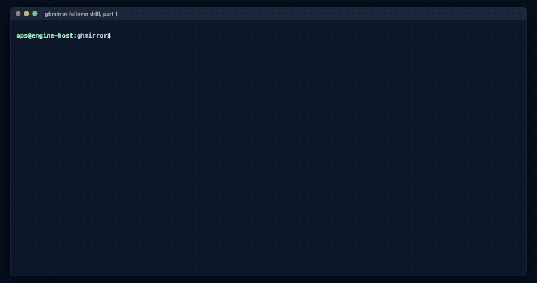
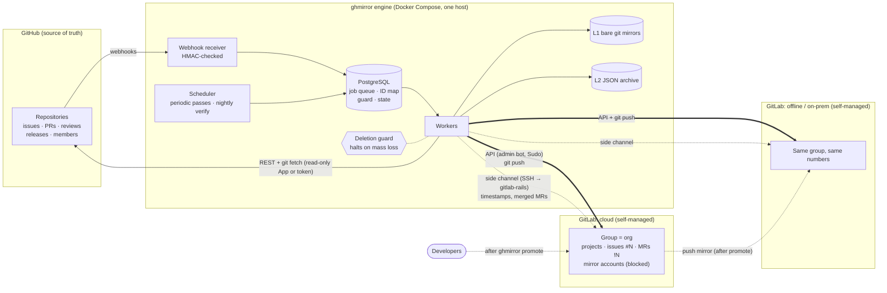

# ghmirror

One-to-one mirror of a GitHub organization (or user account) into **two self-managed GitLab
instances**, one in the cloud and one on-premises, kept in sync automatically, private
repositories included. If GitHub is lost, one command turns a GitLab copy into the team's
primary code host.

- **Faithful:** issues, pull requests (as merge requests with the **same numbers**), reviews, line
  comments, reactions, labels, milestones, releases and people are copied with their original
  authors and timestamps. Merged PRs keep the exact diff that was reviewed.
- **Automatic:** GitHub webhooks plus scheduled passes. A nightly parity check compares both sides.
- **Never destructive:** what disappears on GitHub is archived on GitLab, never deleted. A mass
  disappearance halts all writes.
- **Failover:** `ghmirror promote` activates each person's mirror account (company email, SSO
  link, SSH keys), restores branch protections, enables CI and makes the other GitLab a push
  mirror of the new primary. `demote` undoes it exactly, so drills are safe.

**Full guide with screenshots:** [`docs/ghmirror-guide.pdf`](docs/ghmirror-guide.pdf).
**See it work:** [recorded failover drill](docs/demo) (promote in 7.8 s, a developer merges on GitLab,
demote in 1.2 s).



## Architecture



In normal operation data flows one way, GitHub to both GitLabs, which stay read-only to people.
**Layers:** L1 is a bare git mirror of every repository (any branch or tag can be re-pushed); L2 is
the raw GitHub JSON of every object, kept as evidence; L3 is the GitLab objects themselves.
**Failover** (`ghmirror promote --primary cloud`) stops the GitHub pull, activates the people's
GitLab accounts, re-applies branch protections, enables CI and turns the other GitLab into a push
mirror of the new primary. `ghmirror demote` reverses every step. See
[`docs/SECURITY.md`](docs/SECURITY.md) for the trust boundaries in this picture.

## Quick start

On the engine host (Linux, Docker with Compose v2):

```sh
git clone <this repository> ghmirror && cd ghmirror/deploy/compose
./setup.sh
```

`setup.sh` asks a few questions and then:

1. creates a read-only GitHub App for you (two clicks: *Create*, *Install*), or takes a token;
2. prints one command per GitLab host, which prepares it (side-channel login, sudo rule, admin bot
   and token) and prints a line you paste back;
3. writes `ghmirror.yaml`, `.env`, `identities.yaml` and `secrets/`, checks every connection,
   starts the service and queues the first full copy.

Need a GitLab? `deploy/gitlab/docker-compose.yml` is a ready template (GitLab CE 19.5.3, the tested
version). GitLab.com SaaS is not supported: it cannot impersonate users or keep historical dates.

## Documentation

| | |
|---|---|
| [`docs/ghmirror-guide.pdf`](docs/ghmirror-guide.pdf) | How it works, setup, a screenshot tour, operations, test results, references |
| [`docs/INSTALL.md`](docs/INSTALL.md) | Reproducible installation: pinned versions, interactive and unattended install, upgrades |
| [`examples/`](examples) | Sample configuration (`ghmirror.yaml`, `.env`, `identities.yaml`) exactly as setup writes it |
| [`docs/demo/`](docs/demo) | Recorded failover drill (video and terminal recording) with measured timings |
| [`docs/samples/`](docs/samples) | Real parity-verification reports: clean, with drift, after repair |
| [`docs/SECURITY.md`](docs/SECURITY.md) | Threat model, trust boundaries, secrets, hardening checklist, vulnerability reporting |
| [`docs/CAPACITY.md`](docs/CAPACITY.md) | Storage requirements, GitHub API limits, first-copy time, RPO and RTO (measured) |
| [`docs/SUPPORT-MATRIX.md`](docs/SUPPORT-MATRIX.md) | Supported GitHub and GitLab editions, what is copied, exact limits of the offline copy |
| [`docs/COMMERCIAL.md`](docs/COMMERCIAL.md) | Draft commercial deployment and support offering, open decisions, readiness gaps |
| [`docs/RUNBOOK.md`](docs/RUNBOOK.md) | Operations: steady state, deletion guard, failover, drills, restore |
| [`DESIGN.md`](DESIGN.md) | Full design and decisions |
| [`ROADBLOCKS.md`](ROADBLOCKS.md) | Every risk checked and every defect found in testing, with fixes |
| [`RESEARCH-prior-art.md`](RESEARCH-prior-art.md) | Existing tools and what was learned from them |
| [`engine/README.md`](engine/README.md) | Engine modules and running it without Docker |

## Status

Tested end to end against GitHub.com and two GitLab CE 19.5.3 instances: seed, webhooks,
deletion handling, the deletion guard, a full failover drill and its reversal, with zero drift.
The one-command setup was tested from scratch over real SSH. Organization teams, GitHub App
authentication against live GitHub, wikis and LFS are implemented and unit-tested but were not
exercised end to end (the test account is personal). Details and limits: guide chapters 8 and 9.

## Repository layout

```
engine/          the Python engine (package ghmirror) and its unit tests
deploy/compose/  setup.sh, docker-compose.yml, Dockerfile, example config
deploy/gitlab/   GitLab CE template for a mirror target
e2e/             end-to-end test harness (real GitHub + two GitLab containers)
verification/    roadblock test scripts and their recorded results
docs/            install, security, capacity, support matrix, runbook, PDF guide (+ guide-src/), demo, samples
examples/        sample configuration
```
