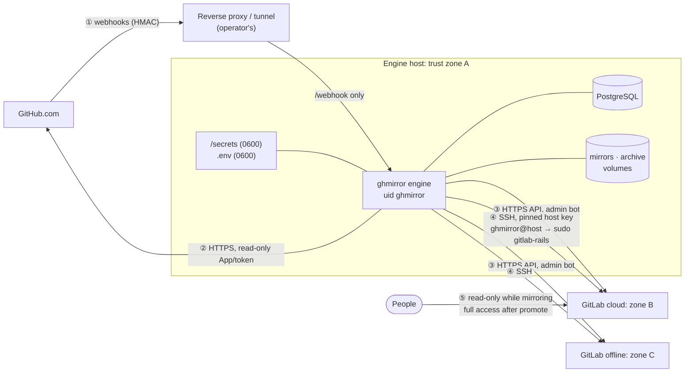

# Security architecture and threat model

This document describes what ghmirror protects, what it trusts, where its secrets live, and what
an attacker who compromises each part would gain. It is written for the person deciding whether to
run ghmirror and for the person operating it. Statements about the code were checked against
the source in this repository; file references are given so they can be re-checked.

## 1. What is being protected

| Asset | Where it lives | Why it matters |
|---|---|---|
| Source code of every repository, private ones included | GitHub; L1 bare mirrors on the engine volume `mirrors`; both GitLabs | The primary asset. A mirror is a second (and third) copy of everything the organization keeps private. |
| Issues, PRs, reviews, comments, attachments | GitHub; L2 JSON archive on volume `archive`; both GitLabs | Often contain credentials pasted by mistake, customer data, security reports. |
| GitLab admin bot token | `.env` on the engine host | Full administrative API access to a GitLab, including impersonation (`sudo` scope). |
| Side-channel SSH key | `secrets/id_ed25519` on the engine host | Root-equivalent on each GitLab host (see §4.3). |
| GitHub credential (App private key or token) | `secrets/github-app.pem` or `.env` | Read access to every repository the App is installed on. |
| Webhook secret, PostgreSQL password | `.env` | Integrity of the job queue; the engine's state. |
| Identity map (`identities.yaml`) | engine host | Company email and SSO identity of each person: personal data. |

The engine host therefore holds **the keys to both GitLabs and a full copy of the code**. It should be
treated with the same care as the GitLab servers themselves, not as a utility box.

## 2. Components and trust boundaries

| # | Boundary | Authentication | Integrity / confidentiality | Code |
|---|---|---|---|---|
| ① | GitHub → engine webhooks | HMAC-SHA256 over the raw body with the shared secret, compared in constant time. **No secret configured means every webhook is refused** (fail closed). Bodies over 26 MB are refused. Duplicate delivery IDs are dropped. | TLS terminates at the operator's proxy; the engine listens on `127.0.0.1:8080` only. A webhook never carries data that is trusted: it only queues a job, and the job re-reads the object from the GitHub API. | `engine/ghmirror/server.py` `verify_signature`, `do_POST` |
| ② | engine → GitHub | GitHub App installation token (1-hour lifetime, minted from the App key) or a token. | The App created by `ghmirror init` requests **read** permission only: contents, metadata, issues, pull requests, discussions, administration, members. It cannot write to GitHub. | `engine/ghmirror/setup.py` `APP_PERMISSIONS` |
| ③ | engine → GitLab API | Personal access token of the admin bot `github-mirror`, scopes `api sudo admin_mode read_api write_repository`, default lifetime 365 days. | HTTPS if the GitLab URL is `https://`. The `Sudo` header is how comments are written as their original authors. | `engine/ghmirror/prepare-host.sh` step 3 |
| ④ | engine → GitLab host side channel | SSH key only (`BatchMode=yes`), host key pinned at setup (`StrictHostKeyChecking=yes` against `secrets/known_hosts`). The `authorized_keys` entry forbids port forwarding, agent forwarding, X11 and a pty. | Runs a `gitlab-rails runner` agent that accepts a fixed set of operations (set timestamps, mark merged, set MR number, approvals, release dates). Used because the API cannot write history. | `engine/ghmirror/sidechannel.py`, `sidechannel.rb`, `prepare-host.sh` steps 1–2 |
| ⑤ | People → GitLab | GitLab's own login, SSO, 2FA. | While mirroring, every mirrored person is a **blocked** mirror account and the group is read-only to them; branch protections are stored but not enforced until promote. | `engine/ghmirror/identity.py`, `promote.py` |

Git traffic carries credentials in an `http.<url>.extraheader` passed through `GIT_CONFIG_*`
environment variables: tokens never appear in a remote URL, in `ps` output or in `.git/config`
(`engine/ghmirror/github.py`, `gitlab.py` `git_env`).

## 3. Secrets inventory

| Secret | Created by | Stored | Rotation |
|---|---|---|---|
| GitHub App private key | GitHub, fetched once by the manifest flow | `secrets/github-app.pem` (0600) | Generate a new key in the App settings, replace the file, restart the engine. |
| GitHub token (token mode) | You | `.env` `GITHUB_TOKEN` | Replace in `.env`, restart. Prefer a fine-grained, read-only token. |
| Migration token (optional) | You | `.env` `GITHUB_MIGRATION_TOKEN` | Classic PAT (`repo`, `admin:org`): the broadest secret on the host; leave it empty unless you want GitHub's migration archives. |
| GitLab bot token, per target | `prepare-host.sh` | `.env` `GITLAB_<NAME>_TOKEN` | Re-run `prepare-host.sh` on that host (it adds a new token), paste the new line into `ghmirror init`, then revoke the old token in GitLab. Expiry is set by `--token-days` (default 365); `ghmirror check` reports days left. |
| Side-channel key | `ghmirror init` (ed25519) | `secrets/id_ed25519` (0600) | Delete the file, re-run `ghmirror init` and `prepare-host.sh`, remove the old line from `~ghmirror/.ssh/authorized_keys`. |
| Webhook secret | `ghmirror init` (256-bit random) | `.env` `GITHUB_WEBHOOK_SECRET`, and GitHub | Change it in both places at once; deliveries in between are refused and recovered by the next scheduled pass. |
| PostgreSQL password | `ghmirror init` (random) | `.env` | Internal to the Compose network. |

Inside the container, `/mnt/secrets` is mounted read-only and copied to `/secrets` owned by the
`ghmirror` user with mode 0600. The engine process then drops root (`setpriv`) and runs as
`ghmirror` (`deploy/compose/entrypoint.sh`). `.env`, `secrets/`, `ghmirror.yaml` and
`identities.yaml` are excluded from git (`.gitignore`) and from the image (`.dockerignore`).

## 4. Threats, impact and mitigations

### 4.1 Forged or replayed webhooks
*Attack:* someone who can reach `/webhook` sends events. *Impact without a secret:* unbounded work
queued (denial of service); no data change, because jobs re-read GitHub. *Mitigation:* HMAC with a
256-bit secret, fail-closed when unset, constant-time comparison, delivery-ID de-duplication, 26 MB
body cap, listener bound to localhost behind the operator's proxy.

### 4.2 Compromise of the engine host
*Impact:* the attacker gains every secret in §3, therefore admin of both GitLabs, root on both
GitLab hosts (§4.3), read access to all GitHub repositories the App can see, and the full code and
metadata copy on the volumes. *This is the highest-impact scenario.* *Mitigations:* dedicated host
or VM; no other workloads; disk encryption; OS patching; SSH to the host restricted to operators
with keys and 2FA; secrets files 0600; no inbound ports except the proxy path to `/webhook`;
backups of `.env`/`secrets/` encrypted and stored separately from the volumes.

### 4.3 The side channel is root-equivalent on each GitLab host
The sudo rule allows the `ghmirror` Unix user to run `gitlab-rails` (Omnibus) or
`docker exec -i <container> …` (Docker). Both can execute arbitrary code as root on the GitLab
host or inside the GitLab container, which holds all of GitLab's data. The fixed operation set in
`sidechannel.rb` limits what **the engine** does, not what **a stolen key** can do. *Mitigations:*
key is unique to ghmirror and never leaves the engine host; host key pinned (no trust on first use
after setup); the login has no pty and no forwarding; restrict the source address of the
`ghmirror` login (`from="<engine IP>"` prefix in `authorized_keys`, or a firewall rule) as an extra
step; audit `/var/log/auth.log` for `ghmirror` logins. If this trade-off is unacceptable, remove
the side channel: ghmirror still mirrors, but timestamps become "now", merged pull requests show as
closed, and merge request numbers may differ from PR numbers (see the support matrix).

### 4.4 Compromise of the GitLab bot token
*Impact:* full admin API on that GitLab, including acting as any user. *Mitigations:* token only
in `.env`; limited lifetime; one token per GitLab (a leak does not cross to the other one); revoke
from the GitLab admin area. GitLab audit events (EE) record its use; on CE review
`production_json.log`.

### 4.5 Compromise of a GitLab instance
*Impact:* that copy is read or altered. The other GitLab and GitHub are unaffected while
mirroring, because data flows only from GitHub. Alterations are detected by the nightly parity
check (`verify`) and overwritten from GitHub by `verify --repair`. After promote, the promoted
GitLab is the source of truth and the push mirror replicates whatever it holds, alterations
included: protect the promoted GitLab as you protected GitHub.

### 4.6 Malicious or mass deletion on GitHub (stolen admin, ransomware, mistake)
*Impact if mirrored blindly:* the copies are destroyed too. *Mitigation:* ghmirror **never deletes**
on GitLab. A repository deleted on GitHub is archived (read-only) on GitLab, not removed; deleted
issues and pull requests are closed and labelled; when a branch is force-pushed or deleted, the
engine's L1 mirror first saves the old tip under `refs/ghmirror-backup/`. If a large share of
repositories disappears at once, the deletion guard halts all writes and alerts
(`ghmirror guard status`). This is the main reason the mirror exists.

### 4.7 Poisoned content from GitHub
Issue bodies, comments and file names are copied as data through the GitLab API; they are not
executed by the engine. Attachments are downloaded only from GitHub's own attachment URLs (`github.com/user-attachments`,
`user-images.githubusercontent.com`, repository `assets`/`files`), never from arbitrary links. CI configuration
in mirrored repositories does not run while mirroring: CI is disabled on mirrored projects until
promote. Review the CI variables and runners you attach before promoting.

### 4.8 Exposure of `/status`, `/metrics`, the redirector
`/status` lists repositories, queue state and recent alerts; `/metrics` exports counters. Both are
unauthenticated and bound to `127.0.0.1`. **Expose only `POST /webhook` through the proxy.** The
optional redirector (`--profile failover`) publishes port 8090 and only answers with redirects
from GitHub-style paths to GitLab paths; it reveals the group and repository naming.

### 4.9 Personal data
`identities.yaml` and the mirror accounts hold names, company emails and SSO identities. Mirror
accounts are blocked until promote, so they cannot log in. Treat the engine host and both GitLabs
as systems that process personal data under your existing policies (retention, subject access,
deletion: removing a person from GitHub does not remove their mirror account; do that by hand when
required).

## 5. Hardening checklist

- [ ] Engine on a dedicated VM, disk encrypted, patched, no other services.
- [ ] Only `POST /webhook` reachable from the internet, over HTTPS, through your proxy or tunnel.
- [ ] `GITHUB_WEBHOOK_SECRET` set (always true after `ghmirror init`).
- [ ] GitHub App (read-only) rather than a personal token; `GITHUB_MIGRATION_TOKEN` empty unless needed.
- [ ] GitLab URLs use `https://`; GitLab hosts patched to a supported version.
- [ ] `from="<engine IP>"` added to the `ghmirror` line in each `authorized_keys`, or a firewall rule.
- [ ] Bot token lifetime set to your rotation period; calendar reminder before expiry.
- [ ] Alerts (`alert_webhook`) go to a channel someone watches; deletion-guard halts are paged.
- [ ] Backups of `.env` and `secrets/` encrypted and stored apart from the data volumes.
- [ ] People's access to the mirror groups reviewed: read-only (Reporter) while mirroring.
- [ ] Failover drill (promote + demote) run at least twice a year; it also proves the keys work.

## 6. Known limitations

- The side channel is root-equivalent (§4.3). It is a deliberate trade-off for faithful history.
- Data on the engine volumes is not encrypted by ghmirror; use disk encryption.
- `/status` and `/metrics` have no authentication; they rely on the localhost binding.
- No automated secret rotation; the procedures in §3 are manual.
- ghmirror has had no external security audit or penetration test.

## 7. Reporting a vulnerability

Do not open a public issue. Report privately through GitHub's private vulnerability reporting on
this repository (Security → Report a vulnerability) or to the maintainer contact listed in
`docs/COMMERCIAL.md` once one is published. Include the version (`git rev-parse HEAD`), the
component, and steps to reproduce. Expected first response: within 5 working days (to be confirmed
as part of the support offering).
