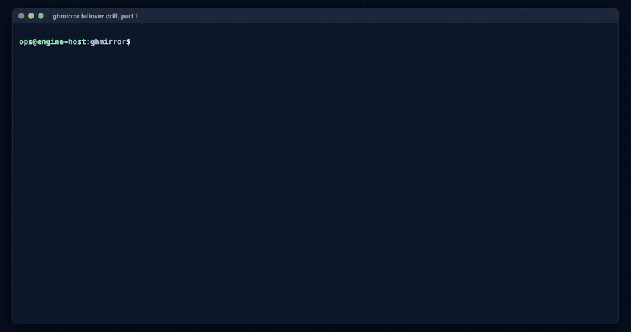

# Recorded failover drill

A live recording made on 2026-11-04. It shows a GitHub repository mirrored into self-managed
GitLab CE 19.5.3, then a failover to GitLab, a developer working on GitLab, and the end of the
drill.

| File | What it is |
|---|---|
| [`ghmirror-failover-drill.mp4`](ghmirror-failover-drill.mp4) | The full drill, 3 min 16 s: terminal, the GitLab UI as the developer sees it, end of drill |
| [`ghmirror-failover-drill.gif`](ghmirror-failover-drill.gif) | Terminal part 1 at 2× speed, for quick viewing |
| [`failover-drill-1-promote.cast`](failover-drill-1-promote.cast), [`failover-drill-2-demote.cast`](failover-drill-2-demote.cast) | The raw terminal recordings (asciicast v2): `asciinema play failover-drill-1-promote.cast`, or upload to asciinema.org |
| [`transcript.txt`](transcript.txt) | The same terminal session as plain text |
| [`ui-poster.png`](ui-poster.png) | A frame of the GitLab part: the failover banner on the developer's GitLab |

## What happens, with measured times

| Step | Command | Result | Time |
|---|---|---|---|
| 1. Healthy mirror | `ghmirror check`, `ghmirror verify` | GitHub reachable, GitLab target `ok`, side channel `ok`; parity: 2 issues and 5 PRs compared, **0 differences** | — |
| 2. GitHub is lost | `ghmirror promote --primary cloud --yes` | GitHub pull stopped; the developer's mirror account activated with their company email; failover banner shown; CI enabled; `failures: []`. `rpo` reports the last sync time per repository | **7.8 s** |
| 3. Work continues on GitLab | `git clone`, commit, `git push`, open merge request, merge | Same history and tags as GitHub. The push shows the failover banner. The new merge request is **!8**, right after GitHub's PRs #3–#7, which are !3–!7 on GitLab. It is merged by the developer's own account | seconds |
| 4. The developer's view | GitLab UI, signed in as the developer | Banner on every page; the MR list with GitHub's PRs plus !8; !3 with GitHub's original author, merger and dates; issue #1 with its comments and reactions | — |
| 5. GitHub is back | `ghmirror demote` | Mirror mode restored, accounts blocked again, banner removed | **1.2 s** |
| 6. After the drill | `ghmirror verify --format markdown` | The drill's work is reported, not lost: `main` on GitLab has the hotfix merge, and !8 exists only on GitLab | — |

## How it was recorded

- **Terminal:** a script fed the commands to a real `bash` in a pseudo-terminal and recorded the
  output with its real timing. The typing is simulated at a steady pace. In the video, pauses
  longer than 2 s are shortened, as `asciinema play -i 2` does. The times printed by `time` are
  the real ones.
- **GitLab UI:** Chrome, driven by Playwright and signed in as the developer, recorded while
  GitLab was promoted. The captions were added on the page during recording.
- **One setup step is not on screen:** after `promote`, the developer's personal access token was
  created for the `git clone` (the equivalent of a developer signing in once and creating a token).
- The demo used the GitLab administrator's token as the engine's bot (`bot root` in the `check`
  output). A real installation uses the dedicated `github-mirror` bot that `prepare-host.sh`
  creates.

## What this recording does not show

- **A second GitLab.** This drill used one GitLab. In the end-to-end test, the other GitLab became
  a push mirror of the promoted one (guide §8.1, e2e step 10). After a promote it receives git
  data within GitLab's 5-minute push-mirror interval.
- **SSO.** The developer signed in with a password set for the demo. In production, the first SSO
  login links to the mirror account (RUNBOOK §1).
- **Returning the drill's work to GitHub** after a real outage. That is a deliberate step for the
  team, for example pushing the branches made on GitLab back to GitHub. The engine never deletes
  them: the parity check reports them, and any commit that exists only on GitLab is saved in the
  engine's git mirror before the next sync resets the branch (ROADBLOCKS E29).

Measured RPO and RTO for a whole estate: [CAPACITY.md](../CAPACITY.md) §4–5.
